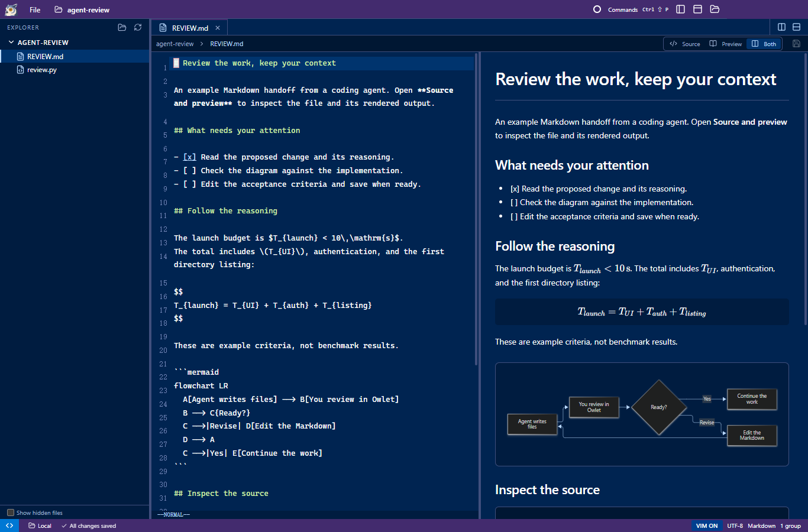

<p align="center"></p>
<p align="center"><a href="README_CN.md">中文</a> | <strong>English</strong></p>

# Owlet

Developers rarely write code by hand anymore. Agents write the code, while humans review plans, track progress, and make decisions. Yet VS Code is built for "90% writing, 10% reading", so remote connections and switching projects feel slow and heavy.

**Owlet** is a fast project editor built for **90% reading, 10% writing**. In daily use, it feels 10x faster than VS Code.

现在人都不怎么手写代码了——Agent 负责写，人负责看方案、盯过程、做决策。但 VS Code 是按「9 分写、1 分看」设计的，连远程切项目又慢又重。

所以我做了一个 **「9 分看、1 分写」** 的极速项目编辑器 **Owlet**，日常交互体感比 VS Code 快 10 倍。



- **Cold-start a project in under 10 seconds.** Opens a full project window in **4.55 seconds** over a bandwidth-limited SSH connection ([test conditions](docs/performance.md)). Run `owlet .` in the integrated terminal to switch directories and open another project window instantly, just like `code .`.
- **Zero-bloat SSH remote.** No persistent heavy server installed on the remote host. Owlet reuses your existing SSH setup, staying responsive even on a Raspberry Pi or a bandwidth-limited jump host.
- **Rich Markdown preview.** Native rendering for math equations, Mermaid diagrams, images, and syntax-highlighted code, with split panes for reading agent-written plans and specs.
- **Peacock project colors.** Spot the right project at a glance across multiple agent windows, or import your existing VS Code Peacock color directly.
- **Familiar VS Code workspace.** File explorer, tabs, split panes, movable terminals, Vim mode, and a command palette. Open files and terminals across split panes.

## Getting started

**Windows portable:** [Download v0.2.0](https://github.com/NekoApocalypse/owlet/releases/download/v0.2.0/Owlet-v0.2.0-windows-x64.zip), extract the complete folder, and run `Owlet.exe`. No Node.js installation required.

1. **Preferred: let your agent do it.** Copy this repository URL into your coding agent (Claude Code, Codex, Antigravity, or OpenCode) and ask it to build and launch Owlet.

2. **Build it yourself.** Requires Windows x64, Node.js 22.12+, and npm.

   ```sh
   npm ci
   npm run build
   npm run package
   ```

   Open `release/Owlet/Owlet.exe`. Choose **Open Local Folder** or **Connect to Remote (SSH)** from the welcome screen, status bar, or command palette (`Ctrl+Shift+P`).

## Limitations

- **Platform support:** Currently **Windows (x64)** only. **macOS and Linux** users are welcome to hand this repository to their own coding agents, bring their own tokens, and contribute cross-platform support.
- **Not yet supported:** Signed installers, automatic updates, and interactive SSH password or MFA prompts. SSH hosts require Linux, Bash, Python 3, and working non-interactive authentication.
- **Out of scope:** Git UI, debugging, language servers, and an extension marketplace. Owlet is a fast, focused tool for reviewing and editing agent work, not an IDE.
- **Current limits:** UTF-8 text up to 4 MiB and raster images up to 16 MiB. Owlet bundles Electron, so a fast workflow does not mean a tiny download or memory footprint.

[Usage and configuration](docs/usage.md) · [Architecture and development](docs/development.md) · [Performance](docs/performance.md)

[MIT License](LICENSE) · [GitHub](https://github.com/NekoApocalypse/owlet)
