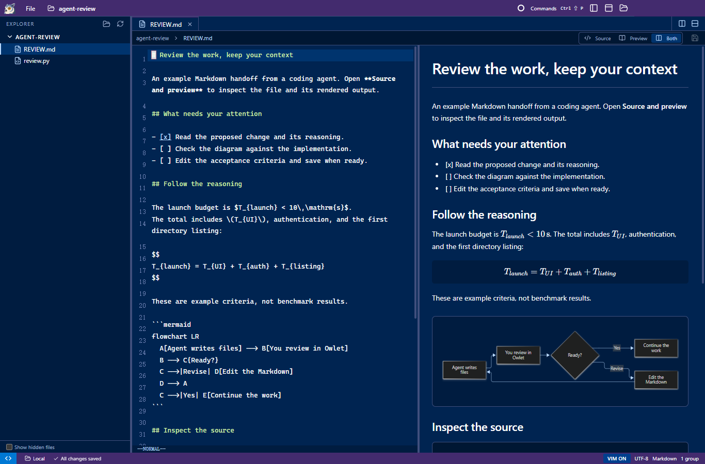

<p align="center"></p>
<p align="center"><strong>中文</strong> | <a href="README.md">English</a></p>

# Owlet — 极速版项目编辑器

现在人都不怎么手写代码了——Agent 负责写，人负责看方案、盯过程、做决策。但 VS Code 是按「9 分写、1 分看」设计的，连远程切项目又慢又重。

所以我做了一个 **「9 分看、1 分写」** 的极速项目编辑器 **Owlet**，日常交互体感比 VS Code 快 10 倍。

Developers rarely write code by hand anymore. Agents write the code, while humans review plans, track progress, and make decisions. Yet VS Code is built for "90% writing, 10% reading", so remote connections and switching projects feel slow and heavy.

**Owlet** is a fast project editor built for **90% reading, 10% writing**. In daily use, it feels 10x faster than VS Code.



- **10 秒内冷启动项目**：限速 SSH 下实测 **4.55 秒** 打开完整项目窗口（[测试条件](docs/performance.md)），集成终端里直接 `owlet .` 秒切目录（体验同 `code .`）。
- **SSH 远程不占带宽**：不在远端装常驻重型 Server，直接复用现有 SSH，树莓派或限速跳板机都不卡。
- **优秀的 Markdown 预览**：原生渲染公式、Mermaid 图、图片与代码高亮，配合分屏（split pane）阅读 Agent 写的 Plan 和 Spec。
- **Peacock 项目主题色**：多开几个 Agent 窗口一眼靠颜色认出项目，支持直接导入 VS Code 现有配色。
- **熟悉的 VS Code 工作区**：文件树、标签页、分屏（split pane）、可移动终端、Vim 模式与命令面板齐备，文件与终端可在分屏间自由组合。

## 快速开始

1. **推荐方式：直接交给你的 Agent。** 把本仓库地址丢给你常用的 Coding Agent（Claude Code、Codex、Antigravity、OpenCode 等），让它直接构建并启动 Owlet。

2. **手动构建。** 环境要求：Windows x64 · Node.js 22.12+ · npm。

   ```sh
   npm ci
   npm run build
   npm run package
   ```

   打开 `release/Owlet/Owlet.exe`。通过欢迎页、状态栏或命令面板（`Ctrl+Shift+P`）选择 **Open Local Folder** 或 **Connect to Remote (SSH)**。

## 当前局限

- **平台支持**：目前只做了 **Windows (x64)** 版本。欢迎 **macOS 和 Linux** 用户直接把仓库丢给自己的 Agent，自带 token 贡献跨平台兼容性。
- **暂未支持**：签名安装包、自动更新，以及交互式 SSH 密码 / MFA 弹窗。SSH 远端主机需具备 Linux、Bash、Python 3 及可用的免密（非交互式）认证。
- **不做的功能**：Git UI、调试器、LSP 语言服务与插件市场。Owlet 专注于快速审阅和轻量编辑 Agent 的产出，不做重型 IDE。
- **当前体积与文件限制**：UTF-8 文本上限 4 MiB，位图上限 16 MiB。Owlet 内置 Electron，轻量流畅指的是交互工作流，而非安装包体积或内存占用。

[使用与配置](docs/usage.md) · [架构与开发](docs/development.md) · [性能测试](docs/performance.md)

[MIT License](LICENSE) · [GitHub](https://github.com/NekoApocalypse/owlet)
