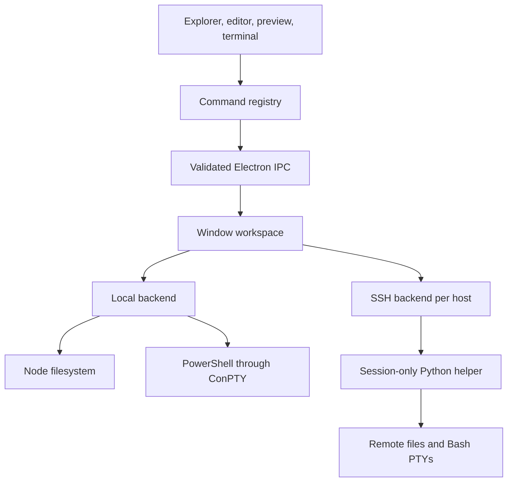

# Develop Owlet

## Architecture

One React interface provides Explorer, CodeMirror, Markdown preview, tab groups, and xterm. Electron's main process owns
workspace access. The renderer uses a restricted preload API with context isolation and no Node access.



`electron/local.cjs` implements local operations. `electron/connection.cjs` handles SSH transport, and `remote/bridge.py`
performs remote operations. `electron/main.cjs` binds windows to backends, scopes connection and terminal events,
and separates cached images by backend identity. Local mode needs no daemon or loopback SSH server.

The package includes `node-pty` and its native Windows ConPTY binaries. The terminal dependency loads when a shell starts.

Each terminal has a stable React owner and PTY. Its imperative xterm DOM surface is reparented into the active panel/editor
slot while the owner stays mounted, preserving scrollback and the running process. Inactive surfaces park in hidden DOM;
resize notifications fit visible terminals without resizing hidden shells to zero. Killing a session unmounts only its owner.

`electron/recent.cjs` stores the last 50 successful workspace locations in the application profile. The main process
records the first successful root listing, deduplicates by backend/host/path, writes atomically, and broadcasts history
changes to open windows. Listing history does not connect to SSH hosts. Empty windows and failed listings are not recorded.

## Command interface

Controls, shortcuts, and the palette share a registry. In the renderer:

```js
window.owletCommands.list()
await window.owletCommands.execute('workspace.openLocal', { path: 'C:/work/project' })
await window.owletCommands.execute('workspace.openSSH', { target: 'my-server', path: '/work/project' })
await window.owletCommands.execute('file.open', { path: 'C:/work/project/REVIEW.md' })
await window.owletCommands.execute('markdown.both')
await window.owletCommands.execute('workspace.state', { readOnly: true })
```

This is an in-process interface, not a network endpoint. `window.lwrCommands` is a legacy alias.
See the [UI-to-command coverage audit](commands.md) and [agent development rules](../AGENTS.md).
Unavailable commands reject execution. Conflict resolution requires confirmation and the compared revision;
stale confirmations cannot overwrite a newer version. Markdown cannot call these APIs.

## Run checks

Recent-window coverage: `node --test tests/recent.test.cjs` and `node tests/recent.cjs` (optionally with `OWLET_SSH_TARGET`).

Local checks require no SSH host:

```sh
npm run build
npm run test:local
node tests/local-ui.cjs
node tests/spacing.cjs
```

For SSH checks, set `OWLET_SSH_TARGET` to a configured test host. `OWLET_TEST_TMPDIR` defaults to `/tmp`.

```sh
npm run test:remote
node --test tests/project-settings.test.cjs
npm run test:ui
node tests/appearance.cjs
node tests/layout.cjs
node tests/performance.cjs
```

Tests use their own fixtures; `artifacts/fixture.json` records the remote directory.
Optional `OWLET_TEST_ZOXIDE_PROJECT` enables a check against an existing zoxide entry.
Set `OWLET_TEST_SSH_TARGET` for `tests/local-ui.cjs` to check mixed local and SSH windows.
Set `LWR_PACKAGED` to the packaged executable to test the portable app.

The performance test defaults to five runs per profile; `LWR_PERF_RUNS` overrides that count. Launch time ends at a usable
directory listing, not when the window frame first appears.

## Source archives

`npm run source:export` makes a clean source archive from an explicit file list. It excludes profiles, binaries, internal
Trust Contracts, skill copies, and historical evidence containing private host details. It does not rewrite this
working repository's history or publish anything.

Owlet is published at [NekoApocalypse/owlet](https://github.com/NekoApocalypse/owlet) under the [MIT License](../LICENSE).
Dependency licenses remain applicable. The portable package preserves Electron's license as `LICENSE.electron`.

## Entry points

- [Windows and IPC](../electron/main.cjs)
- [Local backend](../electron/local.cjs)
- [SSH transport](../electron/connection.cjs)
- [Remote helper](../remote/bridge.py)
- [Command registry](../src/commands.tsx)
- [Workspace UI](../src/App.tsx)
- [Path handling](../src/types.ts)

## Preferences and preview reading

`electron/settings-schema.json` defines labels, defaults, types (via the default), and bounds for the settings UI and backend.
`src/settings.ts` derives the TypeScript settings model and preserves JSONC comments with `jsonc-parser` edits.
`electron/settings.cjs` owns the local user file, validates writes, and checks content revisions before atomic replacement.
The virtual Settings document shares the ordinary dirty-tab/save/conflict flow but never goes through the SSH backend.
Editor fonts use CSS variables and a word-wrap compartment; terminal options update the existing xterm instance and refit its PTY.

Preview find uses MIT-licensed `mark.js` within the rendered article only. Math, SVG, and diagram subtrees are excluded.
The small event adapter in `previewFindCommands.ts` connects independent mounted previews to the command registry without
moving search state into the whole workspace. Preview zoom is window state, separate from saved reading fonts and application zoom.

Focused checks: `node --test tests/settings.test.cjs` and `node tests/preview-settings.cjs` (after `npm run build`).

## Editor highlighting and terminal capabilities

`src/editorLanguages.ts` shares lightweight CodeMirror parsers between source files and Markdown fences. Extension and
fence aliases are case-insensitive; unknown languages remain plain text. Token colors live in `src/Editor.tsx`.

Keep the production build target at ES2021 or newer. Downleveling xterm 6's logical assignment under the current esbuild
minifier corrupts its DECRQM handler and stalls rendering when a TUI queries terminal modes.
See [xterm issue #5800](https://github.com/xtermjs/xterm.js/issues/5800).

After `npm run build`, run `node tests/editor-highlighting.cjs` and `node tests/terminal-capabilities.cjs`.
The latter exercises real PTY mode replies, keyboard input, and shell recovery locally and, when `OWLET_SSH_TARGET` is set,
over SSH. Use `LWR_PACKAGED` to verify the portable executable. Development-server testing alone cannot catch this build bug.

## Background file index and filesystem actions

`src/QuickOpen.tsx` owns a bounded, cancellable metadata scan: startup delay, one page in flight, yielding between pages,
and a pause while foreground file work is busy. Roots/settings/revisions cancel obsolete scans. Cached results remain
searchable during refresh. The hook never downloads file contents. The command registry exposes both the picker and results.

`electron/file-operations.cjs` and `remote/bridge.py` enforce workspace paths, parent realpaths, expected metadata revisions,
and no-overwrite moves. Windows local moves use .NET's non-overwriting operation through a hidden subprocess; UTF-8 JSON
carries paths on stdin, without interpolating shell code. Linux remote moves use `renameat2(RENAME_NOREPLACE)`.
`electron/transfers.cjs` streams local/SSH transfers via temporary files; completed uploads publish with a no-overwrite hard
link. Aborted sessions clean up temporary files; process crashes can leave them. Native Save As replacement rechecks the
existing destination revision. As with ordinary saves, these checks cannot lock out unrelated external writers in every
check-to-operation interval; directory deletion does not snapshot or lock a tree against concurrent external changes.

Vim's existing engine supplies search/substitution and history. Small Ex adapters route saves, save-all, and reloads through
the existing file commands. Reload checks the buffer again after reading so it cannot overwrite newer typing. File operations
hold save locks while pending; new edits arriving during deletion stay in a missing-file buffer.

## Portable releases

The canonical binary distribution is a Windows x64 portable ZIP. Build from the release tag with `npm ci`, `npm run build`,
and `npm run package -- --no-shortcuts`. The flag packages the app without creating or modifying local shortcuts. Archive
the resulting `release/Owlet` directory as `Owlet-v<VERSION>-windows-x64.zip` and publish its SHA-256 checksum alongside it.
Users extract the complete folder and run `Owlet.exe`; Node.js is not needed. App preferences remain in the Windows user
profile. Close older Owlet instances before switching builds; there is no automatic updater.
