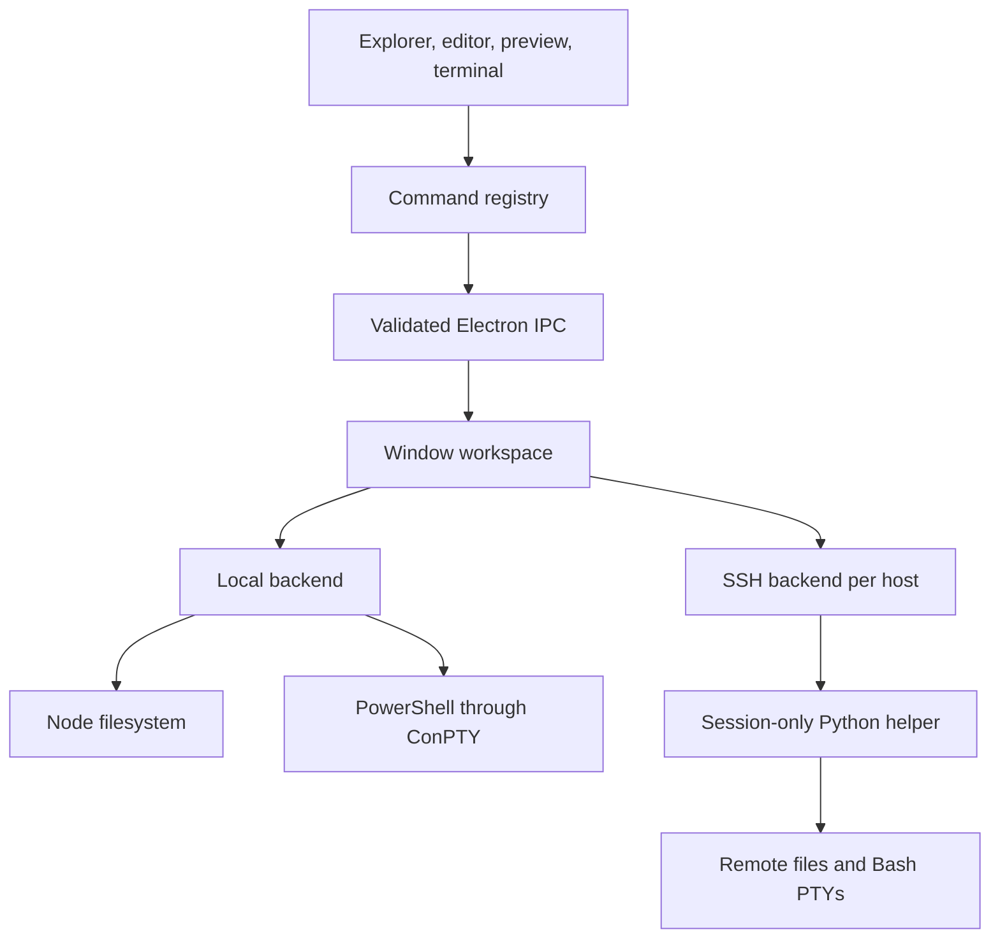

# Develop Owlet

## Architecture

One React interface provides Explorer, CodeMirror, Markdown preview, tab groups, and xterm. Electron's main process owns
workspace access. The renderer uses a restricted preload API with context isolation and no Node access.



`electron/local.cjs` implements local operations. `electron/connection.cjs` handles SSH transport, and `remote/bridge.py`
performs remote operations. `electron/main.cjs` binds windows to backends, scopes connection and terminal events,
and separates cached images by backend identity. Local mode needs no daemon or loopback SSH server.

The package includes `node-pty` and its native Windows ConPTY binaries. The terminal dependency loads when a shell starts.

## Command interface

Controls, shortcuts, and the palette share a registry. In the renderer:

```js
window.owletCommands.list()
await window.owletCommands.execute('workspace.openLocal', { path: 'C:/work/project' })
await window.owletCommands.execute('workspace.openSSH', { target: 'my-server', path: '/work/project' })
await window.owletCommands.execute('file.open', { path: 'C:/work/project/REVIEW.md' })
await window.owletCommands.execute('markdown.both')
await window.owletCommands.execute('workspace.state', { readOnly: true })
```

This is an in-process interface, not a network endpoint. `window.lwrCommands` is a legacy alias.
Unavailable commands reject execution. Conflict resolution requires confirmation and the compared revision;
stale confirmations cannot overwrite a newer version. Markdown cannot call these APIs.

## Run checks

Local checks require no SSH host:

```sh
npm run build
npm run test:local
node tests/local-ui.cjs
node tests/spacing.cjs
```

For SSH checks, set `OWLET_SSH_TARGET` to a configured test host. `OWLET_TEST_TMPDIR` defaults to `/tmp`.

```sh
npm run test:remote
node --test tests/project-settings.test.cjs
npm run test:ui
node tests/appearance.cjs
node tests/layout.cjs
node tests/performance.cjs
```

Tests use their own fixtures; `artifacts/fixture.json` records the remote directory.
Optional `OWLET_TEST_ZOXIDE_PROJECT` enables a check against an existing zoxide entry.
Set `OWLET_TEST_SSH_TARGET` for `tests/local-ui.cjs` to check mixed local and SSH windows.
Set `LWR_PACKAGED` to the packaged executable to test the portable app.

The performance test defaults to five runs per profile; `LWR_PERF_RUNS` overrides that count. Launch time ends at a usable
directory listing, not when the window frame first appears.

## Source archives

`npm run source:export` makes a clean source archive from an explicit file list. It excludes profiles, binaries, internal
Trust Contracts, skill copies, and historical evidence containing private host details. It does not rewrite this
working repository's history or publish anything.

Owlet is published at [NekoApocalypse/owlet](https://github.com/NekoApocalypse/owlet) under the [MIT License](../LICENSE).
Dependency licenses remain applicable. The portable package preserves Electron's license as `LICENSE.electron`.

## Entry points

- [Windows and IPC](../electron/main.cjs)
- [Local backend](../electron/local.cjs)
- [SSH transport](../electron/connection.cjs)
- [Remote helper](../remote/bridge.py)
- [Command registry](../src/commands.tsx)
- [Workspace UI](../src/App.tsx)
- [Path handling](../src/types.ts)
