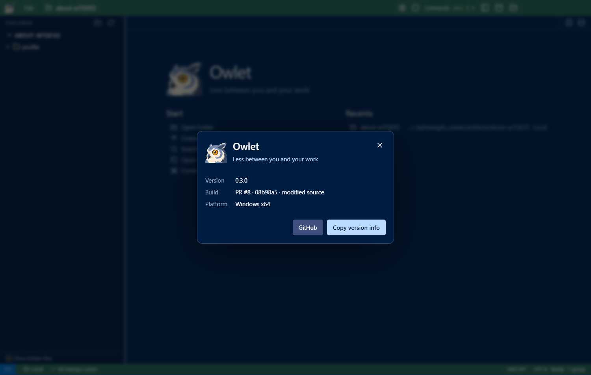

# About Owlet

Open **File → About Owlet** or run **Help: About Owlet** in the command palette. Searching for
version, build, or diagnostics also finds it.

The dialog shows the app version, build label and source commit, and platform. **Copy version info**
adds the full commit, build time and Electron/Chromium/Node versions to a plain-text diagnostic summary.
It does not include workspace paths, SSH addresses or user settings. The GitHub button opens the project.

Each running app reports its own package metadata. Updating a stable launcher does not change the
version shown in an older window. Development/source-archive builds identify missing metadata;
packaging uncommitted source labels it as modified. Release packages record their merged source commit.

Validated in the packaged app through the native File menu, command palette, read-only command API,
clipboard and GitHub action. Escape, keyboard focus containment and the rendered layout were checked.
