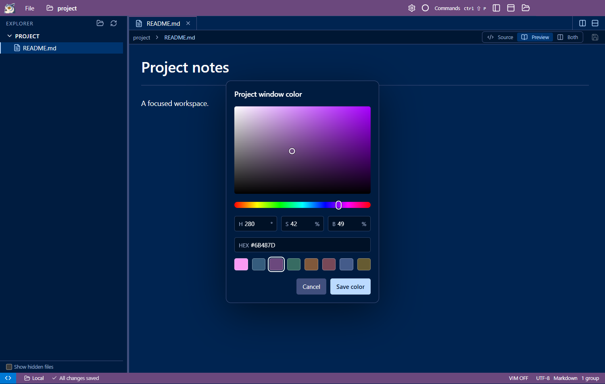

# Project window color picker

Open **Project: Choose Window Color** from the command palette or the title-bar color button.

The compact picker provides a saturation/brightness square, hue slider, HSB fields and HEX entry.
The original eight preset colors remain available below the fields. The actual title/status bars
preview changes immediately, including readable foreground colors. The window stays undimmed
and unblurred while picking, so those colors remain accurate. Save commits the color;
Cancel or Escape restores the saved appearance.

Try dragging outside the square, adjusting hue after choosing gray or black, and typing an incomplete
HEX value. Pointer capture clamps to the square, achromatic colors retain the selected hue, and
incomplete HEX values disable Save while retaining the last valid preview. Arrow keys work in the
square; Shift changes by ten. Numeric fields offer an alternative to dragging.

The picker adds no dependency or remote transfer during adjustment. It keeps the existing single
`peacock.color` setting and revision checks. If another process changes settings while the picker
is open, Save reports a conflict and leaves that file untouched. Close and reopen to load the new value.

Validation: production build; packaged `tests/color-picker.cjs` for UI/API behavior, synchronization,
keyboard/pointer controls, cancellation, save conflicts and restart persistence; existing local and
SSH project-settings regressions; packaged SSH appearance regression for import, cross-window
updates, native window controls and picker saves. Rendered picker inspected at laptop size.
