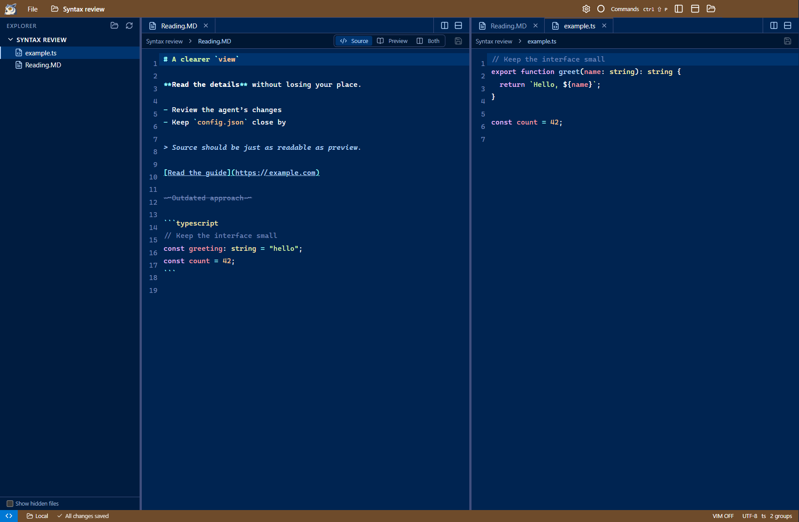

# Review: source highlighting and interactive terminals

Markdown source now distinguishes headings, inline code, list markers, quotes, links, and strikethrough. Fenced code
uses the same lightweight parsers as ordinary code files. Uppercase extensions and `.mdown` work consistently with preview.
No language server or remote dependency was added.

## The `agy` freeze

Reproduced against the configured SSH host with the released portable executable. `agy` sent terminal mode queries and
continued emitting its trust screen, but xterm threw `ReferenceError: i is not defined` in `requestMode`. Its write queue
then stopped parsing subsequent output. The SSH process and transport were still alive.

The production minifier incorrectly downleveled xterm 6's logical assignment at the default older target. Setting Vite's
target to ES2021 avoids that transformation and is supported by the bundled Electron runtime. Compression stays enabled;
there is no custom terminal-protocol interception. This matches [xterm issue #5800](https://github.com/xtermjs/xterm.js/issues/5800).

With the fixed portable executable, the real `agy` trust screen renders, Down selects **No, exit**, Enter exits, and the next
shell command renders normally. No project trust was granted and no agent task was started.

## Verification

All checks used the production build, with UI checks against the separate portable review executable.

| Check | Result |
| --- | --- |
| `npm run build` | Passed; TypeScript and minified production bundle |
| `tests/editor-highlighting.cjs` | Passed: 19 fixtures covering Markdown, fenced TypeScript, common code/config files, case-insensitive detection, unknown-language fallback, and source/preview round trip |
| `tests/terminal-capabilities.cjs` | Passed locally and over real SSH: ANSI/private/unknown mode replies, keyboard input, and return to a usable shell |
| Same capability test against v0.1.0 | Failed at the expected stalled-rendering check |
| Real SSH `agy` | Passed: startup, menu navigation, cancellation, shell recovery; no renderer exception |
| `tests/preview-settings.cjs` | Passed: preview search/zoom, settings, dirty/conflicting saves, live font settings |
| `tests/vim-files.cjs` | Passed: everyday Vim, fuzzy navigation, menus, drag/drop, clipboard and file safeguards |
| `tests/terminal-workspaces.cjs` | Passed: multiple terminals, movement into editor groups, Mermaid viewer, Find/Replace, real SSH concurrent shells and reconnect |
| Windows computer-use inspection | Checked source highlighting, split groups, and the preview toggle in the packaged UI |

## Review locally

1. Open a Markdown file and select **Source**. Try inline code, lists, links, quotes, and a fenced `typescript` or `python` block.
2. Open a `.MD` or `.mdown` file, then a code file. Switch between source and preview; the buffer stays intact.
3. Connect to SSH and run `agy` in an integrated terminal. Check that its interactive screen responds and exiting leaves a usable shell.

## Boundaries

Highlighting is lexical, not semantic. Unsupported languages stay plain text; Mermaid and mathematics remain rich-preview
features rather than new source grammars. JSONC uses the JSON tokenizer, so comments do not get a separate comment style.
The `agy` check covers the reported startup freeze and keyboard interaction, not a complete coding session. The v0.1.0 release
assets remain unchanged; these fixes are in the PR review build.
