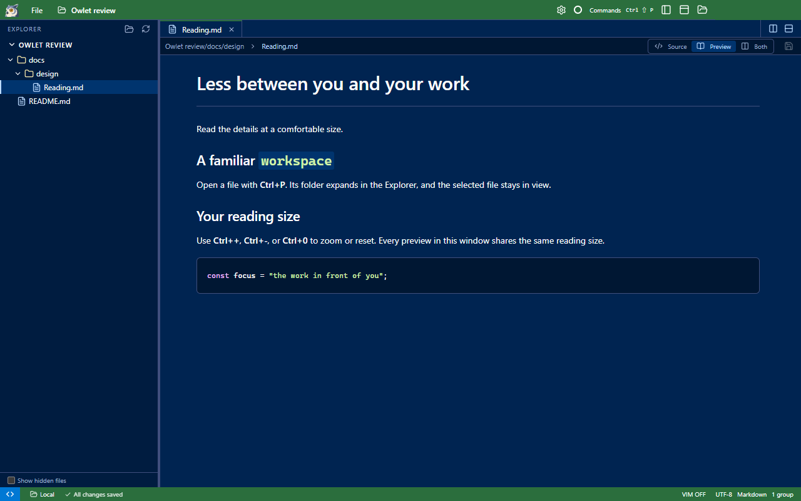
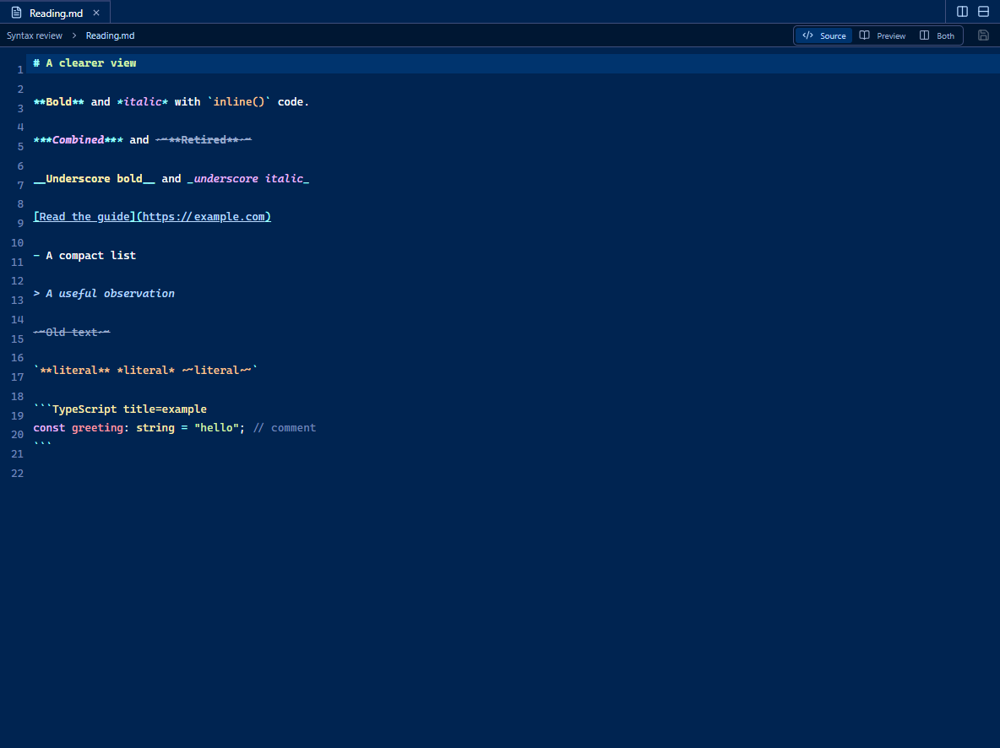

# Review: follow the active file and improve Markdown reading

Opening a file with Ctrl+P, clicking a tab, or focusing a split group now reveals that file in the Explorer. Its parents
expand, its row is selected, and the tree scrolls to it. Keyboard focus stays where you were working.

Preview zoom shortcuts now work immediately after a tab or Explorer click, as well as inside the preview:

- **Ctrl++** or **Ctrl+=**: zoom in.
- **Ctrl+-**: zoom out.
- **Ctrl+0**: reset to 100%.
- Numpad plus/minus and Ctrl+wheel are supported.

All preview panes in the window share the zoom. Source editors, terminals, modal inputs, and the surrounding app UI keep
their own behavior and size. The command palette and shortcuts use the same existing `preview.zoom.*` commands.

Markdown source now gives the enclosed text a visible token color as well as its formatting: bold is warm yellow and bold,
italic is lavender and italic, and strikethrough is muted blue with a line through the text. Delimiters remain visible.
Underscore syntax and nested formatting compose; inline-code contents stay literal.

## Implementation and boundaries

Explorer reveal loads only ancestor listings and any additional pages needed to find the file. It follows the active file
independently of the background Quick Open index, cancels old traversal on tab switches, and does not open a hidden sidebar.
Reopening the sidebar reveals the active file. Hidden files/parents on the active path are shown without changing the
Show hidden files preference. Settings, terminal tabs, and files outside the workspace have no tree row.

Preview keyboard handling is centralized at the window level with focus checks, so it no longer depends on clicking into
the article first. The zoom remains session state, from 50% to 300%; reloading resets it. Mermaid's full-screen viewer keeps
its own controls. This change adds no new settings or backend protocol.

## Validation

- Production build passed.
- Packaged Explorer reveal acceptance passed: Ctrl+P, tab and split-group focus, reactivating a collapsed tab, pagination,
  refresh, hidden paths, hidden sidebar, stale-request cancellation, Windows path case, and real SSH traversal.
- Packaged preview/settings acceptance passed: tab and Explorer focus, plus/minus/reset, numpad keys, wheel zoom, shared
  panes, unchanged Electron UI scale, and source-editor/terminal/palette scope. Existing preview find and settings checks passed.
- Packaged rename regression passed locally and over real SSH, including dirty-buffer preservation and moved workspace roots.
- Packaged file/Vim regression passed: Quick Open during indexing, common Vim commands, menus, moves, external drops, and clipboard actions.
- Packaged highlighting acceptance passed for Markdown and 16 other code/configuration/plain fixtures. Assertions verify the
  enclosed bold/italic/struck text, underscore variants, nested styles, literal inline code, and existing fenced-code colors.
- Windows computer-use inspection checked the visible Explorer selection and preview layout. Native key injection was interrupted
  by detected user input; keyboard behavior was verified by the packaged Playwright acceptance tests above.

## Try it

1. Collapse the Explorer and use Ctrl+P to open a nested file. Its folder chain should expand automatically.
2. Open another file, then switch tabs or click another split group. The Explorer should follow without taking focus.
3. Open Markdown in Preview mode. Click its tab, then press Ctrl++, Ctrl+-, and Ctrl+0. Repeat after opening it from the tree.
4. Open a second preview pane and use Ctrl+wheel. Both previews should resize; the tabs and Explorer should stay the same size.
5. Switch Markdown to Source and compare `**bold**`, `*italic*`, and `~~struck~~` with plain text. Their contents should carry
   both the style and a distinct color; an inline-code span containing the same syntax should remain literal.

This review builds on the welcome-page change in PR #6. It does not replace the published v0.1.0 release.
