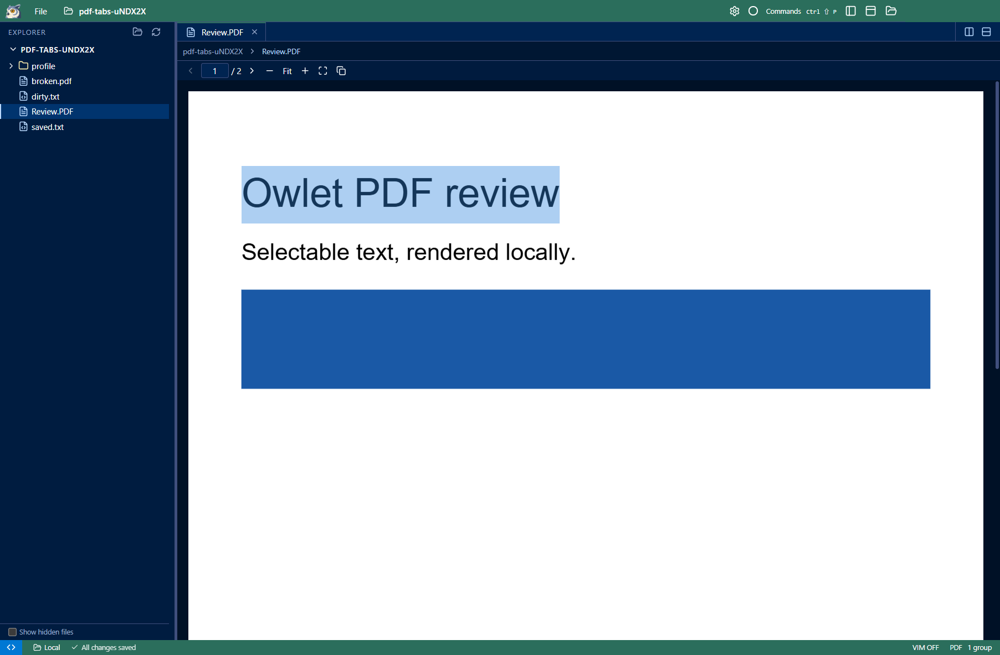
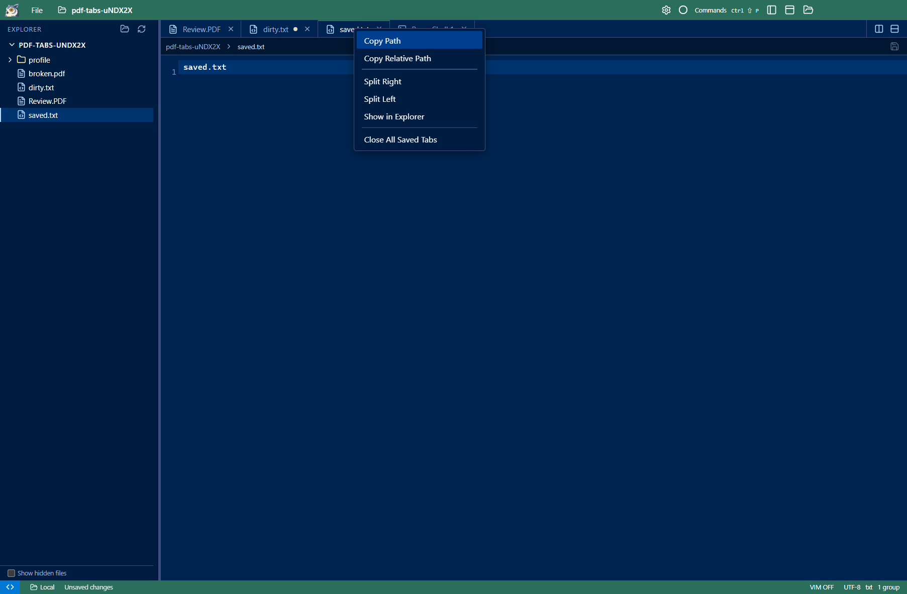

# Review: PDFs and tab actions

PDFs now open as read-only tabs from local and SSH workspaces. Page navigation, page-number entry, zoom, actual size,
fit-to-width and copying page text share the command palette/API handlers. PDF text is selectable; split panes keep
independent page and zoom state. Changed PDFs refresh without reloading the workspace.

PDF.js and its worker/font/CMap assets load locally on demand. Opening a remote PDF transfers only its bytes through the
existing bounded SSH file-transfer queues. The first version downloads the full file, up to 32 MiB, and displays one page
at a time. Password-protected PDFs, forms, annotations, printing and full-document search remain unsupported.
Document scripting is not enabled, remote links/actions are not executed, and the viewer has no Node access.

Middle-click closes the clicked tab through the existing close command. Dirty-buffer and terminal confirmation still apply.
The tab context menu contains Copy Path, Copy Relative Path, Split Right, Split Left, Show in Explorer, and Close All Saved Tabs.
The last action closes clean document tabs across the window; it retains dirty buffers and all terminal tabs.

## Validation

- `npm run build`; `node --test tests/pdf-backend.test.cjs`: unchanged binary bytes, header validation, and size limit.
- Packaged `tests/pdf-tabs.cjs`: actual rendered PDF pages, text layer, toolbar/API navigation and zoom, split-pane state,
  external PDF refresh, malformed PDF error, inert embedded script, lazy loading, tab menu, middle-click dirty guard,
  close-saved behavior, and local/SSH rendering with a configured `OWLET_SSH_TARGET`.
- Existing local/remote filesystem, tab overflow and preview/editor regression tests.

The viewer uses [Mozilla PDF.js](https://mozilla.github.io/pdf.js/), pinned in the lockfile; its Apache-2.0 license is included
in portable packages. PDF rendering assets stay separate from the startup bundle.
