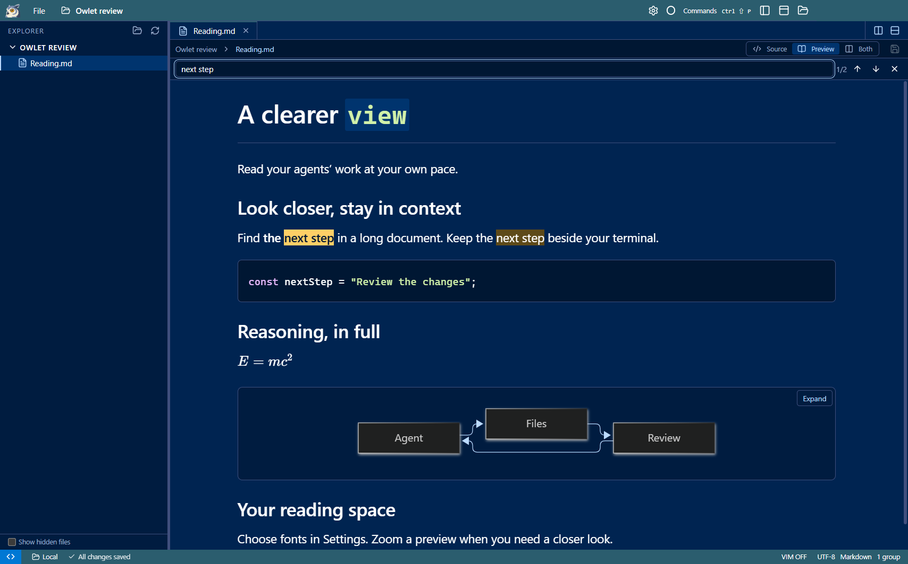
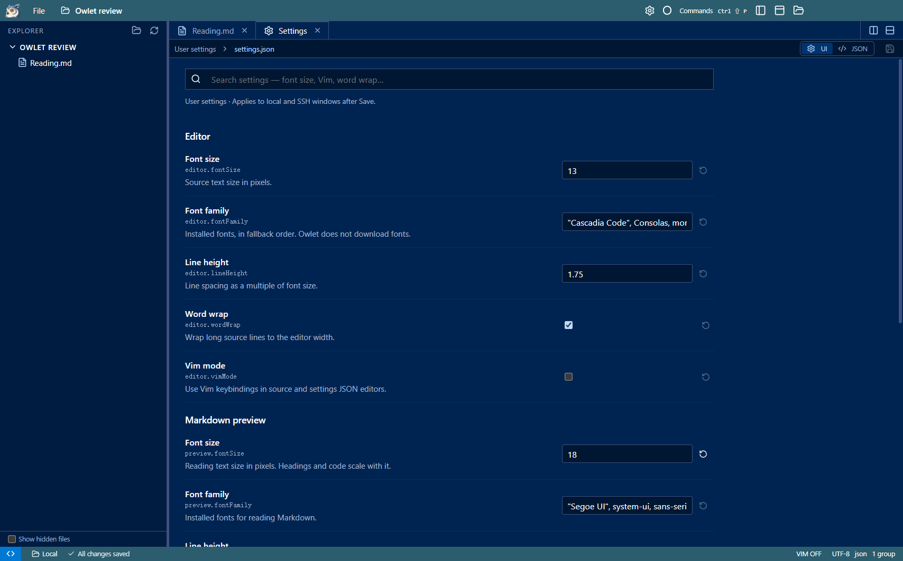
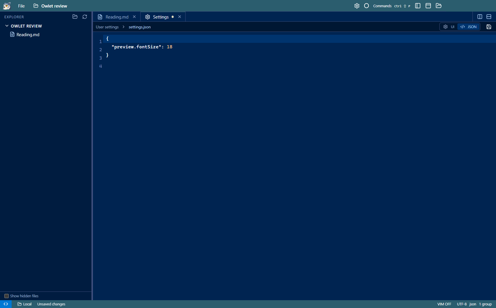

# Preview reading and Settings — review

Owlet now lets you find text without leaving a Markdown preview, zoom your reading panes, and change fonts from a Settings tab.

## What to try

1. Open Markdown and press **Ctrl+F**. Type a phrase, navigate with Enter / Shift+Enter, and close with Esc.
2. Split a second preview. Use **Ctrl++**, **Ctrl+-**, or **Ctrl+wheel** inside either preview: both change together. **Ctrl+0** resets them.
3. Click the **gear** in the title bar or press **Ctrl+,**. Search for `font size` in Settings.
4. Change a value, then switch to **JSON**: it is the same unsaved buffer. **Ctrl+S** applies it. Reset removes an override; Save applies the default.
5. Keep Settings beside a document. Font changes apply live; terminal font changes preserve the running shell.

Inline code in headings now follows the heading's font size and weight. Ordinary inline code and fenced code retain their code styling.

## Screenshots

Preview find searches prose and code while leaving equations and diagrams intact:

Settings is a normal tab with searchable controls and a UI / JSON switch:

JSON mode edits the same configuration, using the existing editor and save safeguards:

The local profile path is masked in the UI screenshot. Screenshots use a dedicated demonstration workspace.

## Configuration model

| Area | Preferences |
| --- | --- |
| Editor | Font size, font family, line height, word wrap, Vim mode |
| Markdown | Preview font size, font family, line height, default source / preview / both view |
| Terminal | Font size, font family, line height, retained scrollback |

A shared schema defines setting names, types, defaults, ranges, and UI descriptions. User preferences are saved to the laptop's Owlet profile as `settings.json`, including when viewing an SSH project. The tab shows the exact path. JSON comments and trailing commas are accepted; UI edits preserve comments and unknown keys. Saved changes propagate across windows in about two seconds. Invalid values cannot be saved, and disk changes are checked before replacement. Existing project colors remain in `.owlet/settings.json`.

Every new action is registered in the command palette and `window.owletCommands`. See [command details](../commands.md#preview-reading-and-preferences) and [usage](../usage.md#preferences).

## Validation

- Production build and TypeScript checks passed.
- Focused acceptance suite passed against source and the Windows portable build: scoped search, formatted phrases, Unicode and literal metacharacters, keyboard navigation, excluded math/diagram content, refreshed files, split panes, shared preview zoom, zoom bounds, and the 1,000-result cap.
- Settings acceptance covered UI/JSON buffer parity, dirty tabs, comments/unknown keys, explicit save, validation failure, external changes, revision conflicts, reset, cross-window synchronization, default Markdown view, and live fonts without replacing the terminal PTY.
- Local backend/settings tests: **5 passed**. Real SSH UI suite: **12 scenarios passed**. Command audit: **124 commands**, with existing UI/API regression scenarios passing.
- Layout checks passed at laptop sizes, with expanded/hidden terminals and application zoom. The resize test allows Windows' observed two-pixel minimum-height rounding at 125% DPI; clipping checks still inspect actual rendered bounds.
- Native computer-use check on the packaged app: gear → Settings tab → search → change preview font → JSON → Ctrl+S, then preview Ctrl+F and Ctrl++.

## Deliberate limits

- Preview find is literal and case-insensitive. It excludes rendered math and Mermaid, offers no replacement or regex, and shows at most 1,000 results. Source search remains available.
- Preview zoom is shared within one window session, from 50% to 300%; it resets on reload. Saved preview font size is the lasting preference.
- User preferences apply across local and SSH windows. Project-level font overrides, settings sync, custom themes, keybinding editors, and a font picker are not included. Fonts must be installed locally.
- Settings edits use explicit Save. This is not VS Code's entire settings framework or extension system.
- Atomic replacement detects changed revisions but cannot lock out an unrelated writer in the final check-to-replace interval, matching the existing file-save limitation.

No changes to SSH transport, remote helper installation, or remote file-write semantics are required for these features.
