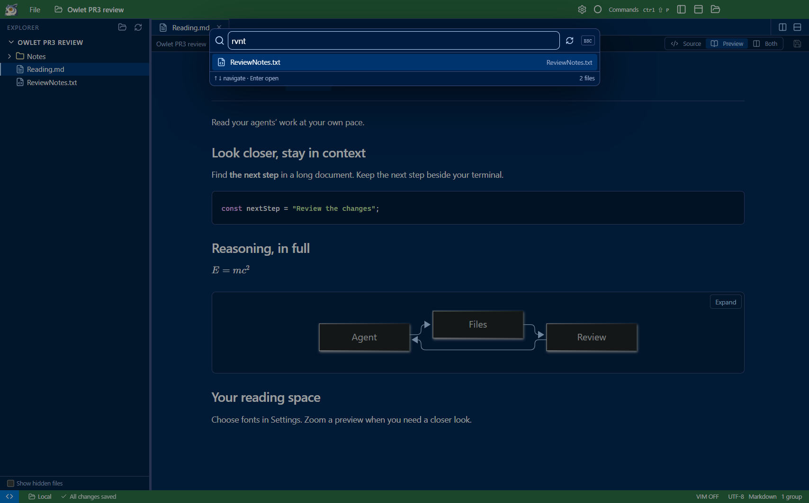
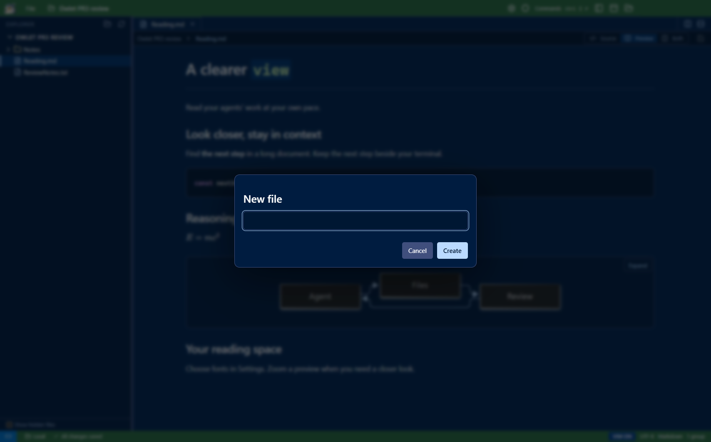

# Reading, settings, and file workflows — review

Owlet now lets you find text inside Markdown previews, adjust reading fonts from Settings, jump to files with Ctrl+P, and manage files from Explorer or tab menus. These additions share one command registry and one PR.

## What to try

1. Open Markdown and press **Ctrl+F**. Type a phrase, navigate with Enter / Shift+Enter, and close with Esc.
2. Split a second preview. Use **Ctrl++**, **Ctrl+-**, or **Ctrl+wheel** inside either preview: both change together. **Ctrl+0** resets them.
3. Click the **gear** in the title bar or press **Ctrl+,**. Search for `font size` in Settings.
4. Change a value, then switch to **JSON**: it is the same unsaved buffer. **Ctrl+S** applies it. Reset removes an override; Save applies the default.
5. Keep Settings beside a document. Font changes apply live; terminal font changes preserve the running shell.

6. Press **Ctrl+P**, type part of a filename or path, and press Enter. The **Indexing…** footer means more results are arriving; opening a result does not wait for the scan.
7. Right-click an Explorer item or file tab. Try creating a file, copying its relative path, or renaming it. Cut/Copy/Paste works on files and folders; copying beside the source picks a new name. Drag a file onto a folder to review a move.
8. Drop a local file into Explorer: it copies in a local workspace and uploads in SSH. SSH file menus offer **Download**.
9. Enable Vim and change the editor font size. Type **:e!** to discard/reload; try **:w**, **:up**, **:wa**, search, and substitution.

Inline code in headings now follows the heading's font size and weight. Ordinary inline code and fenced code retain their code styling.

## Screenshots

Preview find searches prose and code while leaving equations and diagrams intact:

Settings is a normal tab with searchable controls and a UI / JSON switch:

JSON mode edits the same configuration, using the existing editor and save safeguards:

The local profile path is masked in the UI screenshot. Screenshots use a dedicated demonstration workspace.

Quick Open searches fuzzy filenames and paths while the index fills:

File menus use the same compact spacing and colors as the workspace:

## Configuration model

| Area | Preferences |
| --- | --- |
| Editor | Font size, font family, line height, word wrap, Vim mode |
| Markdown | Preview font size, font family, line height, default source / preview / both view |
| Terminal | Font size, font family, line height, retained scrollback |
| Files | Maximum depth for background Quick Open indexing |

A shared schema defines setting names, types, defaults, ranges, and UI descriptions. User preferences are saved to the laptop's Owlet profile as `settings.json`, including when viewing an SSH project. The tab shows the exact path. JSON comments and trailing commas are accepted; UI edits preserve comments and unknown keys. Saved changes propagate across windows in about two seconds. Invalid values cannot be saved, and disk changes are checked before replacement. Existing project colors remain in `.owlet/settings.json`.

Every new action is registered in the command palette and `window.owletCommands`. See [command details](../commands.md#preview-reading-and-preferences) and [usage](../usage.md#preferences).

## Validation

- Production build and TypeScript checks passed.
- Focused acceptance suite passed against source and the Windows portable build: scoped search, formatted phrases, Unicode and literal metacharacters, keyboard navigation, excluded math/diagram content, refreshed files, split panes, shared preview zoom, zoom bounds, and the 1,000-result cap.
- Settings acceptance covered UI/JSON buffer parity, dirty tabs, comments/unknown keys, explicit save, validation failure, external changes, revision conflicts, reset, cross-window synchronization, default Markdown view, and live fonts without replacing the terminal PTY.
- Local backend/settings tests: **5 passed**. Real SSH UI suite: **12 scenarios passed**. Command audit: **140 commands**, with existing UI/API regression scenarios passing.
- Layout checks passed at laptop sizes, with expanded/hidden terminals and application zoom. The resize test allows Windows' observed two-pixel minimum-height rounding at 125% DPI; clipping checks still inspect actual rendered bounds.
- Native computer-use check on the packaged app: gear → Settings tab → search → change preview font → JSON → Ctrl+S, then preview Ctrl+F and Ctrl++.

## Deliberate limits

- Preview find is literal and case-insensitive. It excludes rendered math and Mermaid, offers no replacement or regex, and shows at most 1,000 results. Source search remains available.
- Preview zoom is shared within one window session, from 50% to 300%; it resets on reload. Saved preview font size is the lasting preference.
- User preferences apply across local and SSH windows. Project-level font overrides, settings sync, custom themes, keybinding editors, and a font picker are not included. Fonts must be installed locally.
- Settings edits use explicit Save. This is not VS Code's entire settings framework or extension system.
- Atomic replacement detects changed revisions but cannot lock out an unrelated writer in the final check-to-replace interval, matching the existing file-save limitation.

## Packaged launch check

One cold and one warm launch per profile were measured against the real SSH server with the final portable build:

| Connection | Cold workspace | New workspace window | File window |
| --- | ---: | ---: | ---: |
| Actual VPN | 1.50 s | 0.82 s | 1.46 s |
| 256 kbit/s each way + 250 ms added RTT | 4.44 s | 1.79 s | 3.07 s |

The helper bootstrap is 10,674 bytes. New windows were tested during an image transfer. These are measured samples, not a
latency guarantee for arbitrary servers, authentication, shell profiles, or directory sizes.

## File-workflow validation and limits

- Local and real-SSH backend checks passed: Unicode names, create collisions, workspace-root protection, stale revision rejection, non-overwriting moves, recursive fixture deletion, streamed binary upload/download, interrupted-upload cleanup, and changed-source download rejection. The SSH bootstrap remains below 32 KiB.
- Native Windows computer-use inspection verified the final context menu and Ctrl+P fuzzy selection in an isolated review window.
- Source and packaged UI checks passed: Ctrl+P during an incomplete scan, fuzzy name/path matching, depth/exclusion settings, context-menu targeting, native clipboard paths, file/folder creation, dirty-buffer guards, open-tab rename, tree dragging, and native external file drops, Cut/Copy/Paste, folder copies, and stale clipboard rejection.
- Real-SSH UI checks passed on the portable build: external drop upload, remote-only Download menu, downloaded contents, remote Copy/Paste and Cut/Paste, Vim reload, and fuzzy search.
- Vim acceptance covers typed :e!, dirty :e refusal, failed-read buffer preservation, / search with n/N and :noh, substitution, undo/redo, :w/:up/:wa/:x, filename-argument rejection, and conflict-safe :w!. The Vim panel and input match a 20 px editor font.

The index defaults to five levels beneath the root; it skips dependency/VCS folders and symlink directories. It has scan/file
caps and an explicit partial-state indicator. It is not continuously watched: opening after 15 seconds or pressing Refresh
starts a new scan while retaining available results.

External drops accept regular files only, up to 100 per batch. No folder uploads, overwrite imports, cross-workspace drag,
multi-selection, or drag reordering. Moves and deletes ask for confirmation; deletes are permanent. Local moves require
Windows; remote moves require Linux renameat2. Transfers stream through temporary files; a failed batch can leave earlier
completed files, and the error says how many. A crash can leave temporary files.

Vim uses the existing CodeMirror engine; full Vim scripting/window management is out of scope. Added host commands accept
no filenames or ranges. :w! never overrides conflicts. File operations do not move existing shells to a new working directory.

The SSH session helper now handles guarded file operations and chunked transfers. It remains transient, with no persistent
daemon or remote dependency installation. See [usage](../usage.md#quick-open-and-file-actions) for detailed boundaries.

Cut/Copy/Paste uses a window-local file clipboard, leaving the OS text clipboard and editor text shortcuts alone. Cut is dimmed
until a confirmed move succeeds. Changed selected-item metadata is rejected; a directory is not a snapshot of its children. Folder copies reject symlinks and are
capped at 20,000 items; existing destinations are never replaced. Cross-window clipboard transfers are not included.
