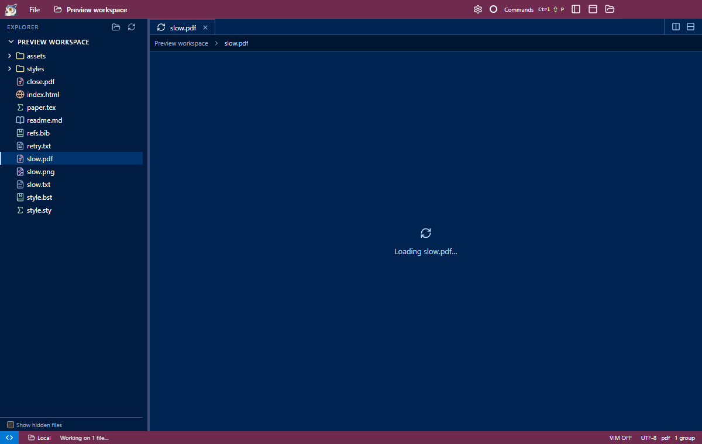
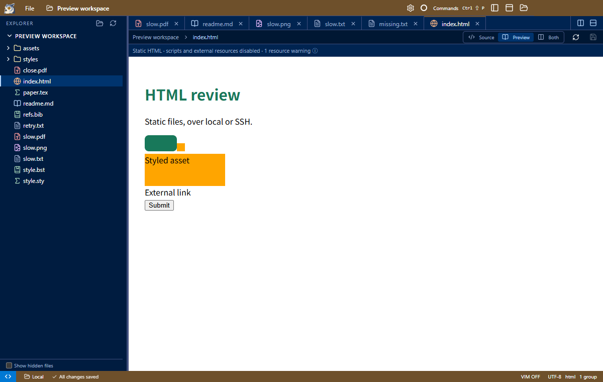
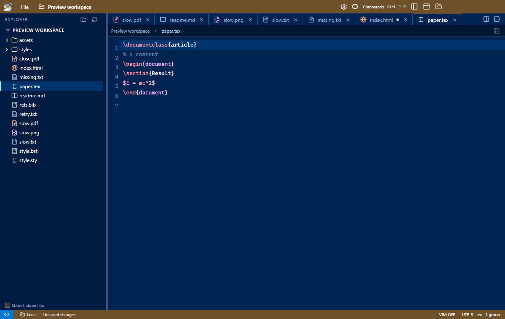

# Responsive opening, HTML previews and file types

Opening a remote file now creates and activates its tab immediately. Explorer reveals the selection
while the content pane shows **Loading…** and a small tab spinner. A slow download can finish in the
background without stealing focus. Closing its tab keeps it closed; failures show an inline Retry action.

HTML files open in a static preview. Source, Preview and Both work through the toolbar and command
palette. Relative stylesheets, nested CSS imports and images are read through the local/SSH backend;
root-relative paths start at the workspace root. Both previews unsaved edits. Refresh reloads resources.

The preview is sandboxed without Node, scripts or network access. It does not start a development
server, run JavaScript applications, load web fonts, or navigate to other pages. Resource and import
limits are documented in [commands](../commands.md). These are static document previews, not a browser.

File icons use the existing [Lucide set](https://lucide.dev/) with distinct shapes and restrained colors
for PDF, Markdown, HTML/XML/SVG, images, LaTeX, bibliography, code, shell, JSON, configuration, tables,
archives, media and plain/unknown files. The [ISC license](https://github.com/lucide-icons/lucide/blob/main/LICENSE)
permits redistribution with its notice; the portable package includes `LICENSE.lucide`.

LaTeX-family files (`tex`, `ltx`, `latex`, `sty`, `cls`, `dtx`, `ins`, `bbx`, `cbx`, `lbx`) use CodeMirror's
TeX tokenizer. BibTeX/BibLaTeX entries and common `.bst` tokens are highlighted too, including entry types,
fields, comments, numbers and strings. Markdown fences recognize `tex`, `latex`, `bibtex` and `biblatex`.
No language server or TeX compiler runs.

Validation: production build; packaged loading/HTML/highlighting tests locally and over SSH, including
the reported PDF; existing PDF/tab, unsupported-file, Explorer and editor-highlighting regressions.
The HTML tests check CSS/import/image resolution, unsaved buffers, command/UI equivalence and sandbox
isolation. The loading test holds transfers open so responsiveness and late-completion behavior are
checked independently of connection speed. Screenshots were inspected at laptop size.
