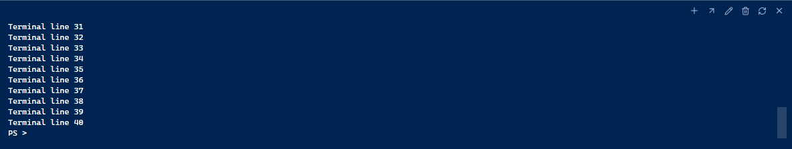

# Review: continuous terminal background

The black strip below the terminal came from xterm's default viewport backdrop. Its rendered rows occupy whole character
heights, leaving a partial-row remainder that exposed the black background. The viewport now matches Owlet's terminal color
in both the bottom panel and editor tabs, without changing row fitting or hiding the input line.

This is a scoped CSS fix. No command, terminal transport, shell, font, padding, or saved preference changes are introduced.

Validation uses the production portable build: Windows visual inspection; 1280×800, 1024×720, and 1440×900 window sizes with
a full terminal buffer; matching viewport/row backgrounds; the last terminal row fits above the status bar. The existing
terminal-workspaces suite checks the backdrop in both panel and editor locations, alongside terminal movement and shell behavior.

To review, fill a terminal with output and resize its panel. The input line should remain fully visible and the space below
it should blend into the terminal. Move the terminal into an editor tab and check the same background there.
