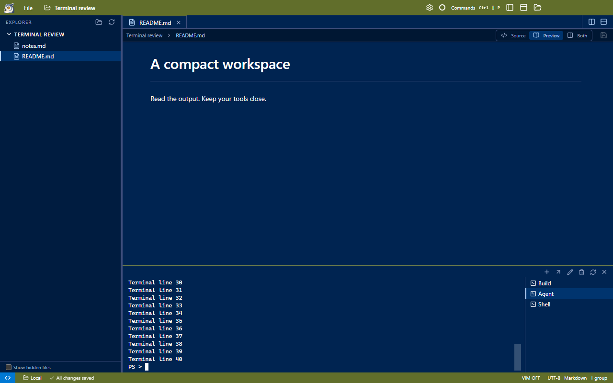

# Review: compact, consistent terminals

The black strip below the terminal came from xterm's default viewport backdrop. Its rendered rows occupy whole character
heights, leaving a partial-row remainder that exposed the black background. The viewport now matches Owlet's terminal color
in both the bottom panel and editor tabs, without changing row fitting or hiding the input line.

The terminal toolbar is 20 px high (previously 24 px). Terminal selector rows now share the Explorer's 22 px height and
12 px label size. Their background matches the terminal pane; square, full-width selection and hover highlights replace
the inset rounded buttons. The selected row also uses the Explorer's left accent. Kill controls remain available on hover
or keyboard focus. Both panel and editor terminal toolbars use the same compact controls.

These are presentation changes. No command, terminal transport, shell, or saved preference behavior changes are introduced.

Validation uses the production portable build: Windows visual inspection; 1280×800, 1024×720, and 1440×900 window sizes with
a full terminal buffer; matching viewport/row backgrounds; the last terminal row fits above the status bar. The existing
terminal-workspaces suite checks the backdrop in both panel and editor locations, alongside terminal movement and shell behavior.
The compact-layout check also measures Explorer/terminal row equality, toolbar height, background equality, and terminal
selection through a click on the visible list.

To review, fill a terminal with output and resize its panel. The input line should remain fully visible and the space below
it should blend into the terminal. Move the terminal into an editor tab and check the same background there.
