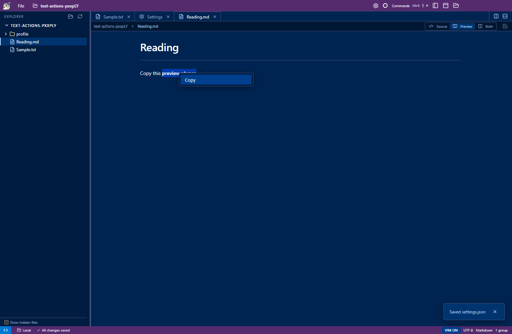

# Review: mouse selection and clipboard menus

Dragging in a source editor selects text, including when Vim mode is on or the drag begins inside an existing selection.
It no longer starts a native text drag that can move characters. Double-click, triple-click, and Shift-click keep their
standard selection behavior.

Right-click a source editor for **Cut**, **Copy**, and **Paste**; right-click a Markdown preview for **Copy**.
These use the text selection and system clipboard independently of Vim commands. Cut and Paste remain unsaved buffer
edits and support Undo. Cut and Copy are disabled when nothing is selected. Preview Copy captures the selection before
the menu takes focus.

## Try it

1. Enable Vim mode, select a few words with the mouse, then begin another drag inside that selection. Text should stay put.
2. Right-click the selection, Copy, then Cut. Paste it back and Undo. The file on disk should remain unchanged until Save.
3. Repeat with Vim mode off.
4. Select formatted text in a Markdown preview and right-click Copy. Paste elsewhere to check the plain text.

The same actions are available as `editor.cut`, `editor.copy`, `editor.paste`, and `preview.copy` in the command palette
and command API. Source commands accept a target group and optional expected path, so automation can address a split pane
without relying on keyboard focus. See [command parameters](../commands.md).

## Validation

The packaged `tests/text-actions.cjs` exercises real mouse drags, both Vim states, clipboard menus, Undo, empty-selection
menus, formatted preview text, split-pane command targeting, and Windows clipboard line endings. Existing Vim/file and
preview/settings acceptance tests cover the surrounding editor behavior.
