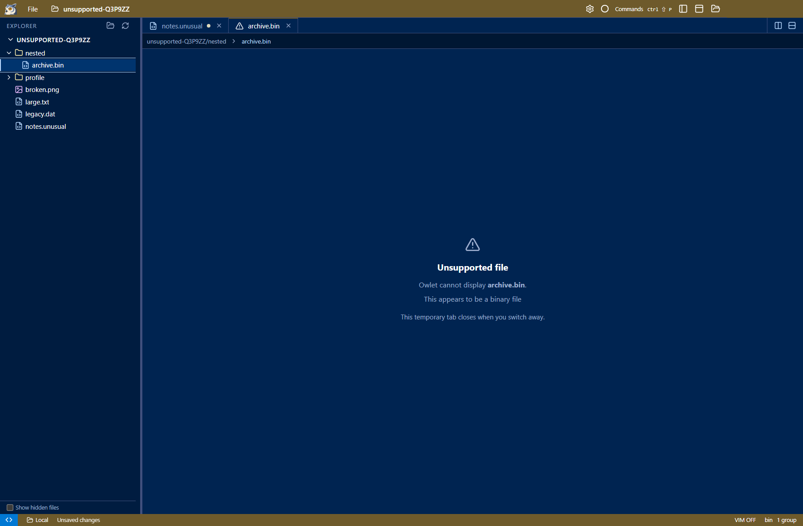

# Review: temporary unsupported-file tabs

When a file's binary content, encoding or size cannot be displayed, Owlet opens a temporary tab with an **Unsupported file**
notice and the actual reason. PDF/image decode failures use the same view. The Explorer opens, expands the file's ancestors,
selects the file and gives its row keyboard focus.

Switching to another file, editor group, or terminal removes the temporary tab. Other files and unsaved edits remain open.
Opening the command palette or changing applications does not remove the notice. Reopening the file after dismissal retries
the read; keeping it open does not repeatedly download or parse unsupported content.

Unknown extensions containing valid text remain readable. Missing paths, permission failures and SSH errors keep their own
error handling instead of being mislabeled as unsupported formats.

## Validation

- Build and packaged `tests/unsupported-files.cjs`: local and configured SSH failures, Explorer focus/reveal, binary/encoding/
  size/image cases, tab/group/terminal dismissal, palette retention, preserved dirty edits, no repeated reads, and retry after
  replacing the file with readable content.
- Existing PDF/tab, Explorer-reveal, and editor clipboard acceptance tests.
