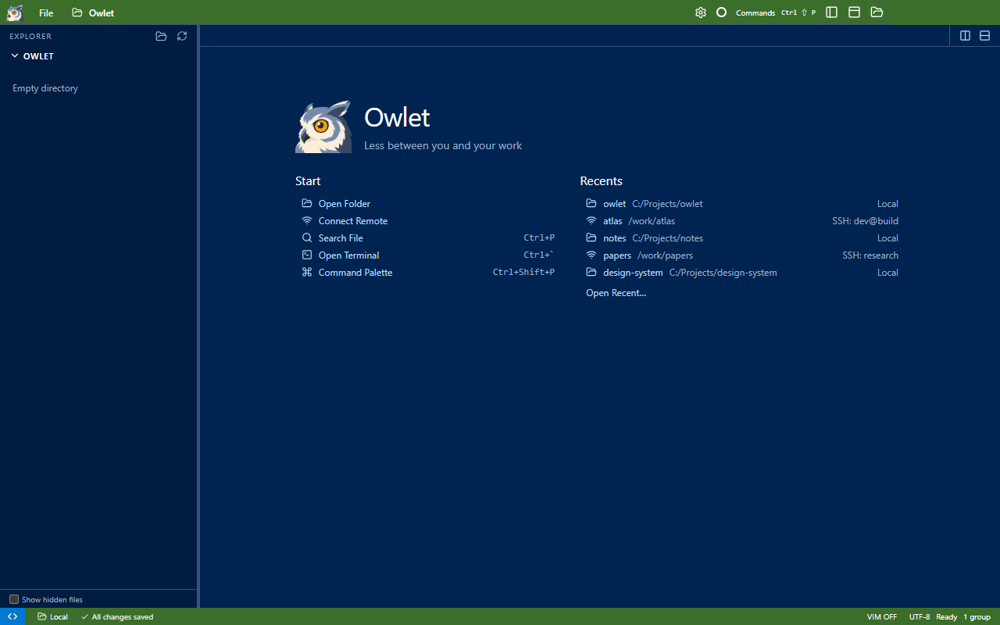

# Review: a useful launch page

The welcome page now has three parts: Owlet's logo, name, and **Less between you and your work**; five Start actions;
and recent local/SSH workspaces. It retains Owlet's existing colors and logo. The layout takes its Start/Recent structure
from [VS Code's welcome page](https://code.visualstudio.com/docs/getstarted/personalize-vscode#welcome-page).

Start opens a folder, connects to SSH, searches files, reveals/focuses the terminal, or opens the command palette. Shortcut
labels accompany Search File, Open Terminal, and Command Palette. Every button uses the existing command registry.
Start and Recents share one row style: 22 px height, 12 px text, 14 px icons, and identical padding.

The six most recent workspaces use compact single-line rows showing a folder name, path, and Local or SSH host. Long paths
truncate from the left, keeping the rightmost path visible; the full location is available on hover. Clicking uses its stored ID to reopen
the exact location. **Open Recent…** opens the complete searchable history. History updates from other windows remain live.
On narrow editor groups, Start and Recents stack instead of overflowing sideways.

## Validation

- Production build passed.
- Packaged `tests/welcome.cjs` passed: branding, Start actions and shortcuts, native folder-picker result routing, local recent
  clicks, real SSH connection and recent reopening, cross-window history updates, full-history picker, empty state, and narrow splits.
- Packaged `tests/recent.cjs` passed, including restart persistence, native File menu, duplicate prevention, removal/clearing,
  stale IDs, and real SSH history.
- Windows computer-use inspection checked the rendered layout; the Start action acceptance test opens the command palette.

The screenshot uses example workspace names and hosts. The SSH acceptance checks use the configured test host.

## Boundaries

Search File and Open Terminal are disabled until the window has a connected workspace, with an explanation on the page.
Open Folder follows the current window's local/remote context. The page appears in empty editor groups; it does not replace
open files or add a persistent Welcome tab. History still stores locations, not tab layouts or terminal sessions.
