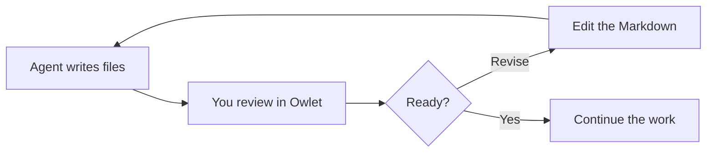

# Review the work, keep your context

An example Markdown handoff from a coding agent. Open **Source and preview** to inspect the file and its rendered output.

## What needs your attention

- [x] Read the proposed change and its reasoning.
- [ ] Check the diagram against the implementation.
- [ ] Edit the acceptance criteria and save when ready.

## Follow the reasoning

The launch budget is $T_{launch} < 10\,\mathrm{s}$.
The total includes \(T_{UI}\), authentication, and the first directory listing:

$$
T_{launch} = T_{UI} + T_{auth} + T_{listing}
$$

These are example criteria, not benchmark results.



## Inspect the source

```python
def within_launch_budget(seconds: float) -> bool:
    return seconds < 10
```

Open [the example source](review.py) in another tab or split group.

## Images travel with the document


Keep your notes as ordinary files. Your agents can read your edits without an export step.
